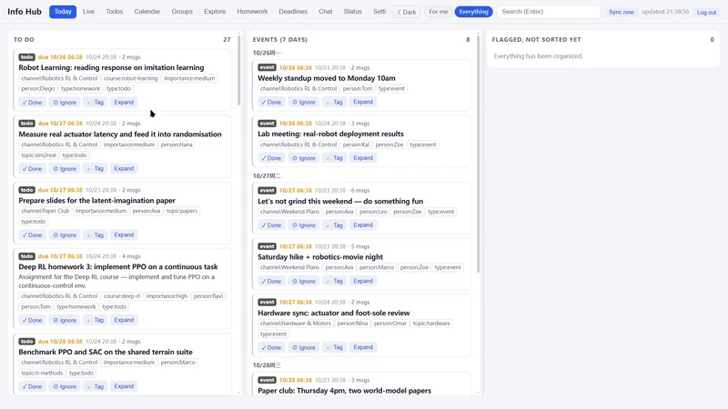
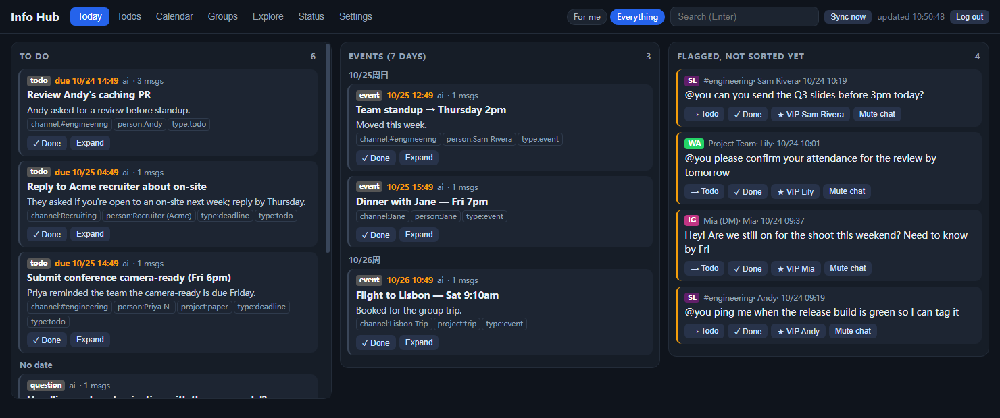
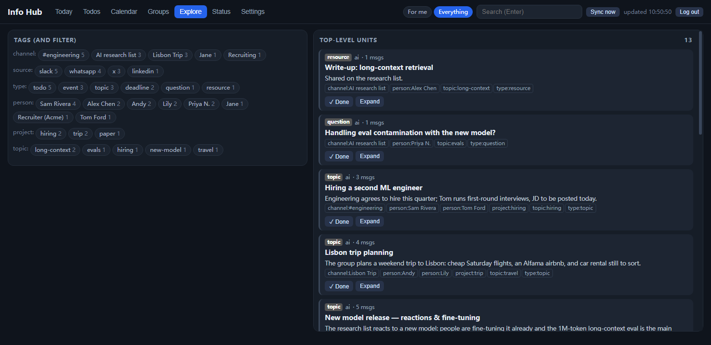
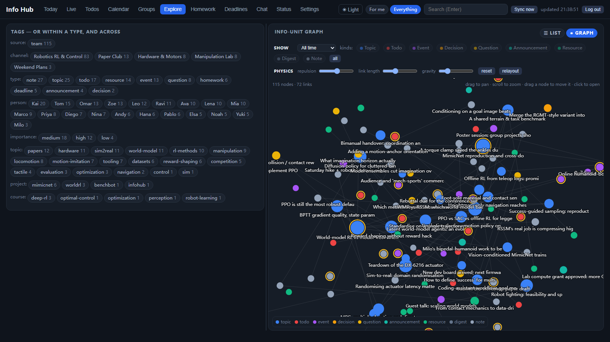
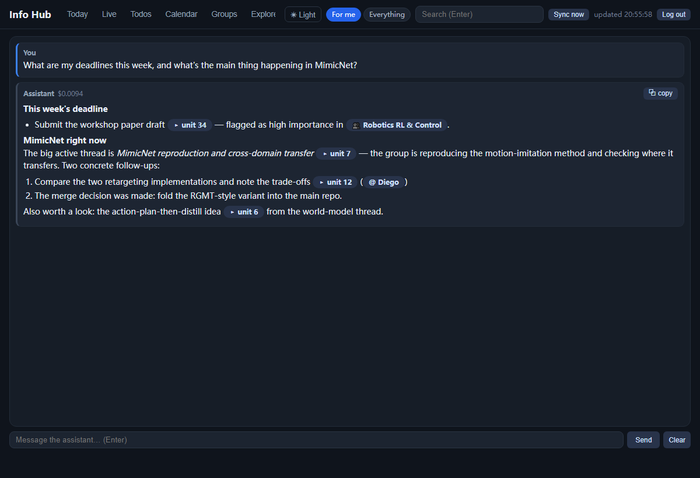
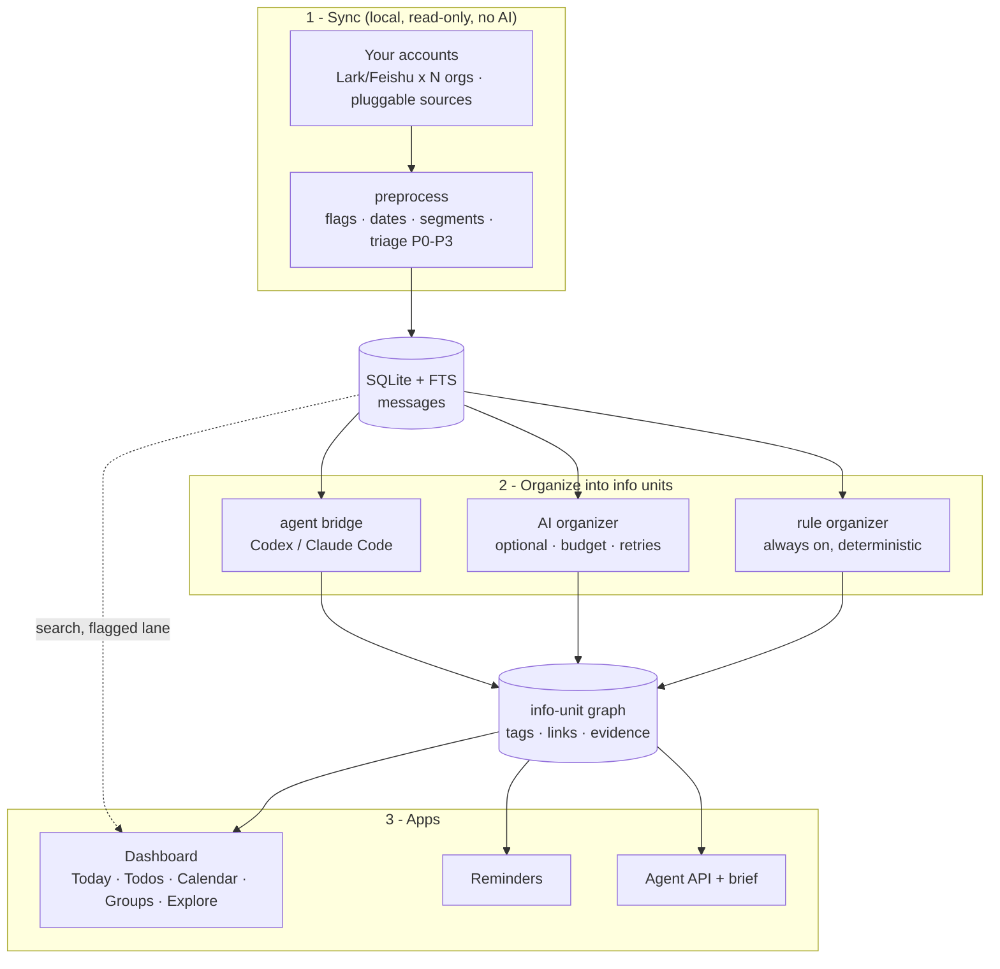

<h1 align="center">Info Hub</h1>

<p align="center">
  <b>One private dashboard for everything coming at you</b> — your chat and messaging accounts,
  turned into tidy <i>info units</i> (tasks, events, topics) you can actually read.
</p>

<p align="center">
  <a href="#get-started"></a>
  <a href="docs/architecture.md"></a>
  <a href="docs/setup.md"></a>
  <a href="LICENSE"></a>
</p>

<p align="center">
  
  
  
  
  
  
</p>

<p align="center">
  
  <br>
  <sub><i>Quick tour: <b>Today</b> for the work that needs attention, <b>Explore</b> for the tagged info-unit graph, and <b>Chat</b> for answers grounded in your organized messages. Synthetic demo data.</i></sub>
</p>

> Chat groups are noisy. Info Hub reads your own Lark/Feishu accounts (and any source plugin you add) **locally and
> read-only**, groups the chatter into main-idea **info units**, and shows you what matters on one
> dashboard — todos, events, a calendar, and topic summaries — with everything staying on your machine.

<details>
<summary><b>Screenshots: Today, Explore, Graph and Chat</b></summary>

<p align="center">
  
  <br>
  <sub><i><b>Today</b> — priorities, events and flagged messages. Synthetic demo data.</i></sub>
</p>
<p align="center">
  
  <br>
  <sub><i><b>Explore</b> — filter units by person, topic, channel or type. Synthetic demo data.</i></sub>
</p>
<p align="center">
  
  <br>
  <sub><i><b>Graph</b> — inspect connected units and open any node. Synthetic demo data.</i></sub>
</p>
<p align="center">
  
  <br>
  <sub><i><b>Chat</b> — streamed answers with links to units, groups and people. Synthetic demo data.</i></sub>
</p>
</details>

> **Try it with the demo data:** `python scripts/seed_demo.py` writes a fictional example database to
> `data/demo.db`; point `hub.database` at it in `config/hub.local.yaml` and run `python -m infohub serve`.

## Chat can organize the graph

Ask the assistant to connect topics, add a unit under several parents, remove a connection,
consolidate duplicate tags, change a unit's kind or dates, and attach message evidence.
It can inspect graph edges and tag counts before editing, and reports the changes it applies.
For example: “Link the reward-design topic under world models”, or “Consolidate topic:rl-training
into topic:reinforcement-learning”. Chat needs an OpenAI-compatible model configured in Settings.

## How it works



**It runs every day without AI.** Layer 1 and the rule organizer are deterministic. The AI organizer is a separate, optional worker: if the API is down, over budget or not configured, its jobs wait in a queue and nothing else is affected. Full design in [docs/architecture.md](docs/architecture.md).

## What it never does
- It sends, posts or edits nothing on any platform. Dashboard actions only change local state.
- It never commits data. `data/`, `config/*.local.yaml` and `logs/` are git-ignored.
- It sends no message text to an AI service unless `ai.enabled: true`, and then only for chats whose policy is listed in `ai.policies` (default: chats you marked **Watch**).
- It listens only on 127.0.0.1 by default, rejects foreign Host headers and cross-origin writes, and requires login once an account exists.

## Get started

**With a coding agent** (Claude Code, Codex, …) — clone the repo, open it in your agent and paste:

```text
Please set up Info Hub for my Lark/Feishu organizations on this machine.
Follow docs/setup.md: run the non-interactive steps yourself, and for each browser
approval open the page and tell me what to click. I have N organizations: <names>.
```

**By hand** — follow [docs/setup.md](docs/setup.md). The short version (Git, Python 3.10+, Node 18+):

```bash
git clone https://github.com/MasterYip/InfoHub.git
cd InfoHub
python -m venv .venv && . .venv/bin/activate      # Windows: .\.venv\Scripts\activate
pip install -r requirements.txt && npm install    # npm installs the official lark-cli
cp config/hub.example.yaml config/hub.local.yaml
# once per Lark/Feishu organization, approve in the browser inside that organization:
npx lark-cli config init --new --name org1
npx lark-cli auth login --profile org1 --domain im,calendar,task,contact
python -m infohub doctor
python -m infohub run
```
Then open http://127.0.0.1:8765/ and set your chats and names in **Settings**. Full steps,
multiple organizations, AI, autostart and remote access are in [docs/setup.md](docs/setup.md).

## Windows desktop and tray

For a dedicated window, install the optional desktop packages and launch:

```powershell
.\.venv\Scripts\python.exe -m pip install -r requirements-desktop.txt
.\scripts\start-desktop.ps1
```

Close the window to keep Info Hub in the tray. Click the tray icon to reopen it, or use
**Open in browser** for the original web interface. The tray groups new-unit notifications,
can limit them to **For me**, and opens the latest unit when a notification is clicked.
Use `scripts/install-autostart.ps1 -Desktop` to start in the tray at logon.
See [desktop setup and behavior](docs/desktop.md) for lifecycle, login and notification settings.

## Automatic database backups

Info Hub makes a verified database copy on first service startup, then every **7 days**.
Change the interval in **Settings → Database backups**, run a copy immediately with
**Back up now**, and check the last successful backup and next due time there.
Completed copies are kept in `data/backups/` and excluded from Git. See
[backup configuration and recovery](docs/backups.md).

## Scheduled agents (Codex, Claude Code, ...)
An external agent can do the Layer 2 work on a schedule instead of, or alongside, the API worker:
- `python -m infohub agent next` leases jobs as JSON (`instructions`, `schema`, `jobs`); `agent submit results.json` applies the results. Leases expire, so an abandoned run never loses work.
- `python -m infohub agent context --days 1` returns a brief plus counts for other agent-team tasks. HTTP equivalents: `/api/agent/next`, `/api/agent/submit`, `/api/agent/context`.
- `agents/scheduled-run.md` is the instruction file. `scripts/agent-run.ps1` (or `.sh`) runs `agent.command` from your config, e.g. `codex exec --full-auto`. `scripts/install-agent-schedule.ps1 -Hours 2` registers a Task Scheduler entry; on Linux use the cron line in `agent-run.sh`.
- Set `ai.queue_for_agents: true` to queue work for agents while the API worker is off.

## Commands
| Layer | Command | Purpose |
|---|---|---|
| 1 | `python -m infohub sync [--source <name>]` | One sync round, plus the rule organizer (prints counts only) |
| 2 | `python -m infohub organize [--ai] [--requeue DAYS]` | Rule organizer; `--ai` runs queued AI jobs; `--requeue` queues past chats |
| 2 | `python -m infohub agent next` / `agent submit FILE` / `agent context` | Scheduled or external agents (lease protocol) |
| 3 | `python -m infohub brief --days 7 --tags course:ai-engineering` | Markdown brief for agent-team tasks |
| 3 | `python -m infohub remind` | Toast reminders for due todos and upcoming events |
| — | `python -m infohub run` | The service: all layers on their own schedules, plus the dashboard |
| — | `python -m infohub stats` / `doctor` | Counts and health (no message text) |

The HTTP API is documented at the top of [infohub/apps/server.py](infohub/apps/server.py).

## Remote access and login
To open the dashboard from other devices, create an account (`python -m infohub user add <name>`), forward the port through your public server, and use HTTPS. Once an account exists, every page and API call requires login; the browser keeps a 30-day session cookie. See [docs/remote-access.md](docs/remote-access.md).

## Running on an always-on machine
The hub runs anywhere `lark-cli` does. See [docs/architecture.md § Deployment](docs/architecture.md#deployment); reach it from other devices via a tunnel with login ([docs/remote-access.md](docs/remote-access.md)).
