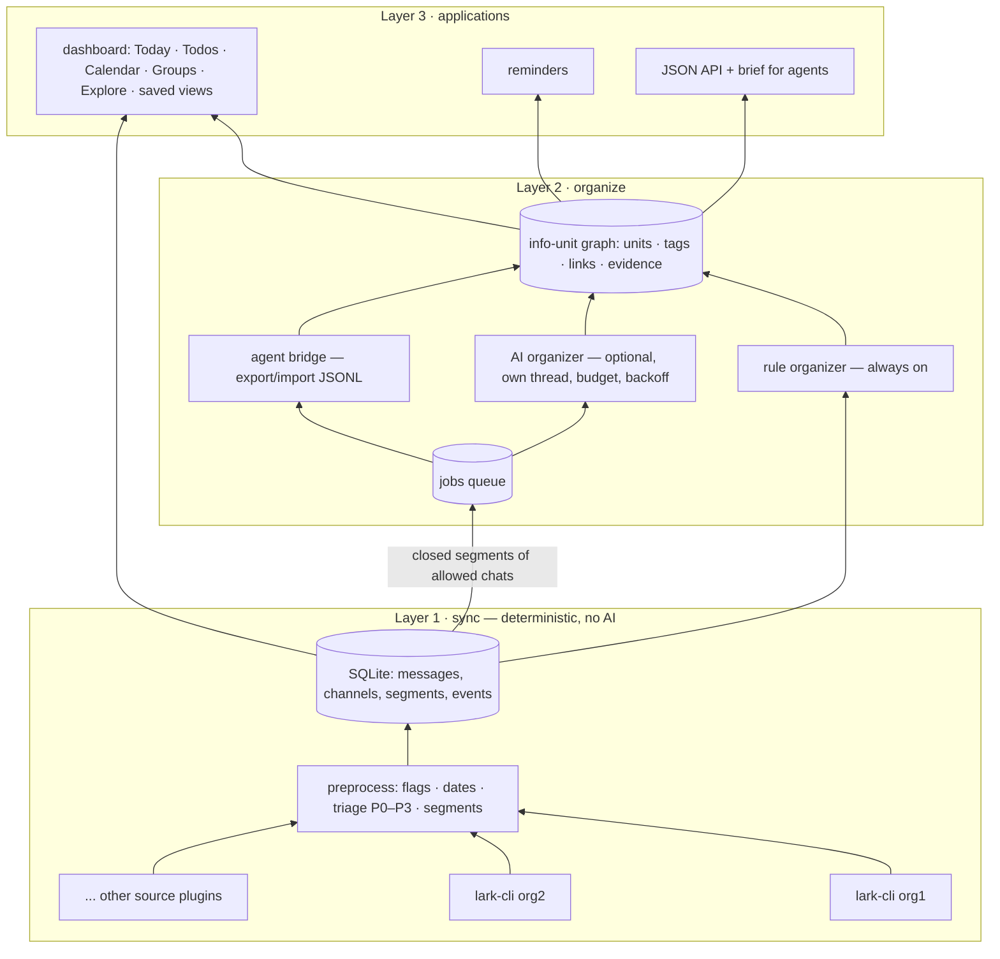

# Info Hub architecture

## Layer 1 — sync
- **Collectors (source plugins)** are read-only. Lark/Feishu uses the official `lark-cli`, one profile per organization (`sources.lark.accounts`); more sources can be added as plugins. Each source keeps its own cursor, so a failure in one source (or one organization) is logged and the others continue.
- **Preprocessing** works on every message: kind, @mention detection, link and question flags, and a date/time parser for Chinese and English ("明天下午3点", "下周一", "10月30日", "next Friday").
- **Triage** assigns each chat a policy (`watch` / `store` / `digest` / `ignore`) and each message a priority P0–P3. It uses config lists, priority rules and dashboard overrides.
- **Segments** group messages into conversation bursts: messages in one chat with no pause longer than `segment_gap_minutes`. Layer 2 works on segments.

### Flagging and priority (Layer 1 triage, deterministic)

This is the first-layer, no-AI flag mechanism (`infohub/sync/triage.py`), run on every message at sync time:

- **Policy** (per chat): `watch` (AI reads it), `store` (searchable, no AI), `digest` (summary only), `ignore` (hidden). Set by your chat defaults (`policy_defaults`), then overridden by anything you choose by hand in Settings.
- **Priority** (per message): `P0` (top) → `P3` (background). A message starts at `P2` in a watched chat, `P3` otherwise, and is raised by:
  - an **@mention of you** (`me.names`) → P1;
  - a **priority rule** matching (`rules` in the config), e.g. `deadlines-meetings`;
  - a **VIP** sender → P1, but only for substantial messages, never trivial acks.
- **"Actionable"** gate: the `deadlines-meetings` rule only fires when a message states a real **obligation** (截止, 作业, 提交, deadline…) **plus** a date or an instruction aimed at the reader — and is not someone recalling something (`我记得…`), a done-notice (`已提交…`), or a one-liner. The same `NOT_A_TASK` / `ASK` / `OBLIGATION` logic is shared with the Layer-2 rule organizer, so a chat line like `他好久没提交过了` is never flagged.
- **"For me"**: a unit is *yours* only when its evidence is **directed at you** — it @mentions you, it is your own message, or it is a one-to-one chat. A VIP person's own task stays theirs. The global **For me / Everything** toggle filters every tab by this flag.

The **"Flagged, not sorted yet"** lane on Today shows only P0/P1 messages that are actionable or @mention you and that no organizer has turned into a unit yet — a safety net, not a dumping ground. For watched chats, the real context-aware attention items are the AI's topics (Layer 2), surfaced under "For me".

## Layer 2 — reorganization
**Info unit** = one main idea. `kind` is one of topic, todo, event, decision, question, announcement, resource, digest or note. A unit has a title (the idea, not a sentence), a summary, status, due/start times and an origin (rule, ai, agent, user, sync). It also has:
- **tags**, namespaced, as many as needed: `type:` `topic:` `project:` `course:` `person:` `channel:` `source:`. Filtering by any combination of tags reorganizes the same units into different views.
- **links**, which form a directed graph (`parent → child`, multiple parents allowed, cycles refused). Units nest recursively, like knots in a mind map: chat-day → topic → todo.
- **evidence**: the messages that support the unit.

Organizers:
1. The **rule organizer** (always on) creates todo/deadline, event, announcement, resource and question units from keywords plus parsed dates. It hangs them under a per-chat-per-day container and applies `organize.tag_rules`. Calendar events become event units. Its titles are message text, which is good enough to act on.
2. The **AI organizer** (optional; DeepSeek or Claude) turns each closed segment of an allowed chat into main-idea units. It nests them, reuses existing units instead of duplicating them, and closes todos the conversation shows as done. It uses the Claude API with JSON-schema structured output and a cached, fixed system prompt. It runs in its own loop with a daily USD budget. A failure leaves the job pending with exponential backoff, and authentication or model errors stop that run only.
3. The **agent interface** gives the same contract to external or scheduled agents (Codex, Claude Code). `agent next` leases jobs with instructions and schema; `agent submit` validates the results and applies them through the same code path as the API worker. Leases expire after `agent.lease_minutes`, and `scripts/agent-run.ps1` plus `install-agent-schedule.ps1` run an agent on a schedule.

Providers (`organize/providers.py`): `openai_compatible` (DeepSeek by default, stdlib HTTP, JSON-object output with the schema in the system prompt) or `anthropic` (Claude, JSON-schema structured output, cached system prompt). Keys come from the environment variable named in `ai.api_key_env`. 401/402/404 errors stop the run and leave jobs queued; 429/5xx/network errors back off per job.

## Layer 3 — applications
- **Dashboard** tabs: Today (needs you, todos due within 7 days, events), Todos, Calendar (events and deadlines by day), Groups (per-chat digest with its units), Explore (multi-tag AND filter plus the expandable unit tree with evidence), saved views (`apps.views`, e.g. Homework), and Status (per-layer runs, AI queue and spend).
- **Reminders**: Windows toast notifications for todos due within `todo_lead_hours` and events within `event_lead_minutes`. Each unit is reminded once.
- **Agent interface**: `GET /api/units`, `/api/unit/<id>?depth=2`, `/api/tags`, `/api/brief`, `/api/search`; `POST /api/units` and `/api/unit/<id>`. `python -m infohub brief` writes the same brief as Markdown for agent-team tasks.

## Data and privacy
Everything lives in `data/hub.db` (git-ignored). Schema v1 databases are moved to `hub.v1.bak.db` automatically, and dashboard overrides carry over. Low-priority and done messages older than `retention_days` are pruned unless a unit cites them.

## Deployment

Each source brings its own constraints (an API token, an installed CLI, a logged-in client). Lark/Feishu
needs only `lark-cli` with its own app and token per machine, so the hub runs anywhere — your computer or
an always-on server. Point other devices at it over a tunnel with login (see `docs/remote-access.md`).

## Sources are plugins

Each info source is a self-contained plugin in `infohub/sources/` (see that package's docstring for
the contract: `NAME`, `DEFAULT_CONFIG`, `sync()`, optional `refresh`/`doctor`/`init`). The core
discovers them at runtime and never imports a source by name, so sources are **add/remove-only**:
drop a module in `infohub/sources/` to add one, delete its file/folder and config block to remove one.
Lark/Feishu ships as `infohub/sources/lark.py`; Layers 2 and 3 are source-agnostic and never change.
